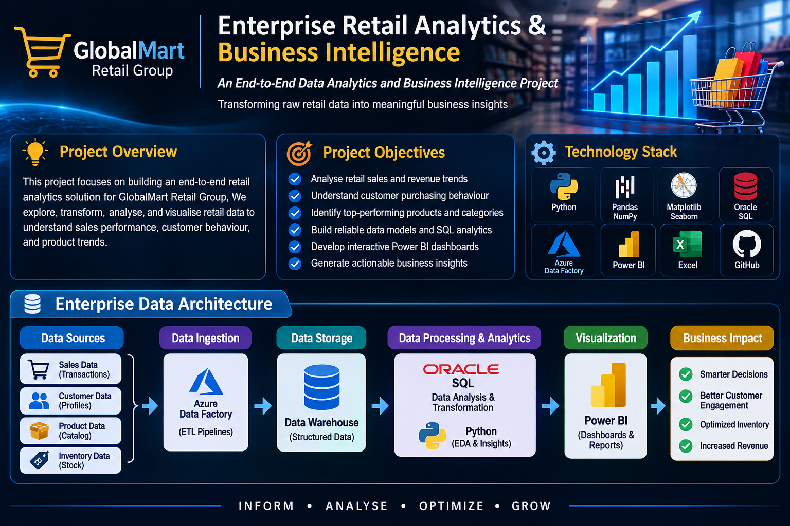

# Enterprise Retail Analytics & Business Intelligence

<p align="center">
  <strong>An End-to-End Data Analytics and Business Intelligence Project</strong>
</p>

<p align="center">
  Transforming raw retail e-commerce data into meaningful business insights through data engineering, analytics, and interactive dashboards.
</p>

<p align="center">
  
</p>

---

## Project Overview

This project focuses on developing an end-to-end retail analytics solution for a fictional enterprise, **GlobalMart Retail Group**.

The objective is to transform raw e-commerce data into structured, reliable and meaningful business intelligence using data engineering, SQL, Python, statistical analysis and interactive visualisation.

The project follows an enterprise-oriented analytical workflow, from understanding business requirements to delivering actionable insights.

## Business Challenges

Retail businesses often face challenges such as:

- Limited visibility into sales and revenue performance.
- Difficulty understanding customer purchasing behaviour.
- Inconsistent customer retention.
- Identifying high-performing and underperforming products.
- Fragmented reporting and data quality issues.
- Difficulty converting raw data into actionable insights.

## Project Objectives

- Analyse sales and revenue trends.
- Understand customer purchasing behaviour.
- Identify top-performing products and categories.
- Evaluate seller and order performance.
- Build structured analytical data models.
- Perform data quality checks and validation.
- Develop interactive Power BI dashboards.
- Generate actionable, data-driven business insights.

## Technology Stack

| Technology | Purpose |
|---|---|
| Python | Data analysis and transformation |
| Pandas & NumPy | Data manipulation and processing |
| Matplotlib & Seaborn | Exploratory data visualisation |
| Oracle SQL | Data modelling and business analysis |
| Azure Data Factory | Pipeline orchestration (subject to feasibility) |
| Power BI | Interactive dashboards and reporting |
| Excel | Data validation and reconciliation |
| Google Colab | Cloud-based development and experimentation |
| VS Code | Project development and code organisation |
| GitHub | Version control and documentation |

## Data Architecture

The proposed solution follows this high-level analytical workflow:

**Data Sources → Data Ingestion → Data Processing → Data Warehouse → Advanced Analytics → Power BI → Business Insights**

Architecture diagrams will be added as the implementation progresses.

## Dataset

This project uses the **Brazilian E-Commerce Public Dataset by Olist**, available on Kaggle.

The dataset contains nine CSV files covering different aspects of e-commerce operations.

### Dataset components

| Dataset | Description |
|---|---|
| Customers | Customer information |
| Geolocation | Geographic location information |
| Order Items | Products associated with orders |
| Order Payments | Payment information |
| Order Reviews | Customer reviews |
| Orders | Order details and status |
| Products | Product information |
| Sellers | Seller information |
| Category Translation | Product category translations |

**Dataset source:** [Brazilian E-Commerce Public Dataset by Olist – Kaggle](https://www.kaggle.com/datasets/olistbr/brazilian-ecommerce)

*Note: The available dataset does not directly contain physical store inventory snapshots, supplier procurement records or marketing campaign performance. These will not be presented as actual source data.*

## Project Workstreams

### 1. Revenue & Sales Intelligence
- Revenue and order analysis.
- Sales trends over time.
- Payment analysis.
- Order status analysis.

### 2. Customer Intelligence
- Customer segmentation.
- RFM analysis.
- Customer purchasing patterns.
- Retention and cohort analysis.

### 3. Product Intelligence
- Product category performance.
- Top-selling products.
- Product review analysis.
- Seller performance.

### 4. Operational Intelligence
- Order processing analysis.
- Delivery and shipping performance.
- Late delivery analysis.
- Geographic performance.

### 5. Advanced Analytics
- Exploratory data analysis.
- Statistical analysis.
- Predictive modelling where supported by the data.

### 6. Executive Business Intelligence
- Executive KPI dashboards.
- Sales and revenue reporting.
- Customer and product insights.
- Business recommendations.

## Project Roadmap

| Phase | Description | Status |
|---|---|---|
| 1 | Business Understanding | In Progress |
| 2 | Data Understanding | Planned |
| 3 | Data Profiling | Planned |
| 4 | Data Cleaning & Quality | Planned |
| 5 | Data Modelling | Planned |
| 6 | SQL Development | Planned |
| 7 | ETL Development | Planned |
| 8 | Exploratory Data Analysis | Planned |
| 9 | Advanced Analytics | Planned |
| 10 | Power BI Dashboards | Planned |
| 11 | Testing & Validation | Planned |
| 12 | Final Documentation & Delivery | Planned |

## Repository Structure

```text
Enterprise-Retail-Analytics-Business-Intelligence/
│
├── README.md
│
├── data/
│   ├── raw/
│   └── processed/
│
├── notebooks/
│   ├── 01_data_understanding.ipynb
│   ├── 02_data_profiling.ipynb
│   ├── 03_data_cleaning.ipynb
│   └── 04_exploratory_data_analysis.ipynb
│
├── src/
│   ├── data_processing/
│   ├── analytics/
│   └── utilities/
│
├── sql/
│   ├── data_modeling/
│   ├── transformations/
│   └── business_queries/
│
├── dashboards/
│
├── docs/
│   ├── requirements/
│   ├── architecture/
│   ├── data_dictionary/
│   └── reports/
│
├── tests/
│
└── .gitignore
```

## Expected Deliverables

- Business requirements documentation.
- Data profiling and quality reports.
- Data cleaning and transformation workflows.
- Database design and data models.
- SQL analytical queries.
- Python analysis notebooks and scripts.
- Interactive Power BI dashboards.
- Business insights and recommendations.
- Technical documentation.

## Project Goals

The goal is to demonstrate practical skills in:

- End-to-end data analytics.
- Data engineering concepts.
- SQL-based data analysis.
- Python programming and analytics.
- Business intelligence development.
- Data quality and validation.
- Analytical problem-solving.
- Communicating business insights.

## Project Information

| Detail | Description |
|---|---|
| Project | Enterprise Retail Analytics & Business Intelligence |
| Organisation | GlobalMart Retail Group (Fictional) |
| Domain | Retail & E-Commerce Analytics |
| Project Type | End-to-End Portfolio Project |
| Development | In Progress |

---

<p align="center">
  <strong>INFORM • ANALYSE • OPTIMISE • GROW</strong>
</p>

